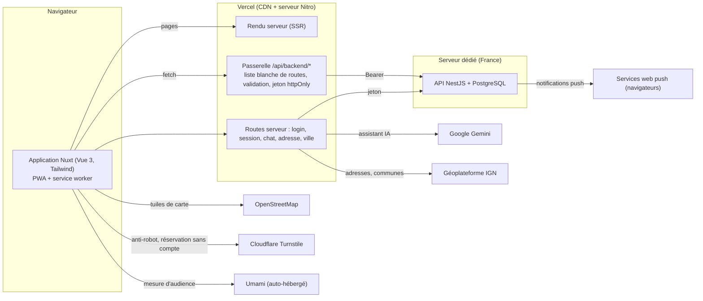

# Léya — le site (front)

Léya met en relation des **patients** et des **praticiens en médecines douces** (ostéopathie, sophrologie, naturopathie, hypnose, massage bien-être, acupuncture…) : un assistant IA oriente le patient, l'annuaire permet de trouver un praticien près de chez soi (liste et carte) et de prendre rendez-vous en ligne ; les praticiens gèrent leur fiche, leur agenda et leurs demandes dans un espace dédié.

Production : <https://leya-sante.fr> — Ce dépôt contient le **site** (Nuxt 4). L'API (NestJS) et sa base de données sont dans un autre dépôt, sur un serveur dédié.

## Fonctionnalités

| Côté | Fonctionnalités |
|---|---|
| Visiteur / patient | Assistant IA (réponses structurées, médecines suggérées, praticiens proches), pages de médecines, recherche par ville (rayon de 15 km), nom, médecine et filtres, **carte** (Leaflet + OpenStreetMap), fiche praticien, réservation (avec compte ou sans compte), export iCal, « Mes rendez-vous », préférences de recherche, export et suppression des données |
| Praticien | Tableau de bord, agenda (jour, semaine, mois), rendez-vous (confirmer, refuser, proposer un autre créneau), fiche avec aperçu en direct, horaires, absences, prestations, statistiques de vues, lien d'abonnement à l'agenda (iCal), notifications push |
| Administration | Demandes de revendication de fiches (approuver, refuser), badge « Profil vérifié » |
| Transverse | PWA installable et notifications web push, **démo praticien** (`/demo`, données fictives, entièrement dans le navigateur), SEO (sitemap, données structurées), mesure d'audience respectueuse (Umami, sans cookie), pages légales |

## Architecture



Principes :
- **Le navigateur n'appelle jamais le serveur d'API directement.** Tout passe par la passerelle (`server/api/backend/[...path].ts`) : seules les routes de sa liste blanche sont relayées, les corps de requête et les paramètres sont validés, les champs privés (e-mail, RPPS, SIRET…) sont retirés des réponses publiques, et le jeton d'authentification (cookie `httpOnly`) n'est jamais lisible côté navigateur.
- **Rien n'est enregistré sur le serveur pour le chat** : la conversation vit dans la mémoire du navigateur et disparaît à la fermeture de l'onglet.
- **Aucune donnée de santé** n'est stockée par ce site ; les rendez-vous ne contiennent qu'un motif facultatif de 500 caractères au plus.

## Pile technique et choix

| Besoin | Choix | Pourquoi |
|---|---|---|
| Framework | **Nuxt 4** (Vue 3, TypeScript, Nitro) | Rendu serveur pour le référencement (annuaire, pages de médecine), routage par fichiers, passerelle serveur intégrée |
| Style | **Tailwind CSS 3.4** + polices Unbounded / Futura (Jost) | Fidélité aux maquettes Figma, jetons de couleurs partagés, aucune feuille de styles inutilisée |
| Hébergement | **Vercel** | Déploiement continu à chaque push, CDN, HTTPS, optimisation des images |
| Carte | **Leaflet + OpenStreetMap** | Légère (≈ 50 Ko, contre ≈ 210 Ko pour MapLibre, comparé et écarté), sans clé ni compte, fonctionne sans WebGL |
| Assistant IA | **Google Gemini** (via une route serveur) | Réponses en continu, clé secrète jamais exposée au navigateur |
| Adresses | **Géoplateforme IGN** | Gratuit, français, appelé depuis le serveur (le navigateur ne contacte pas de service tiers) |
| Assainissement du HTML | **marked + DOMPurify** | La réponse de l'assistant est affichée en HTML : liste blanche de balises, liens `noopener` |
| Tests | **Vitest**, **Playwright**, **axe-core** | Voir [tests/README.md](tests/README.md) |

## Installation

Prérequis : **Node.js 22 ou plus** et npm.

```bash
npm install
cp .env.example .env     # puis renseigner NUXT_GEMINI_API_KEY (assistant IA)
npm run dev              # http://localhost:3000
```

Sans clé Gemini, tout le site fonctionne sauf les réponses de l'assistant. Sans configuration, le site interroge l'API de production en lecture (annuaire, fiches) ; les comptes et les rendez-vous sont ceux de la production.

### Variables d'environnement

| Variable | Rôle | Obligatoire |
|---|---|---|
| `NUXT_GEMINI_API_KEY` (ou `GEMINI_API_KEY`) | Clé de l'API Gemini (assistant) | Pour l'assistant |
| `NUXT_GEMINI_MODEL` | Modèle Gemini | Non |
| `NUXT_API_BASE` | Adresse de l'API (par défaut le serveur de production) | Non |
| `NUXT_PUBLIC_GUEST_BOOKING` | Active la réservation sans compte en production (`true`) | Non |
| `NUXT_PUBLIC_TURNSTILE_SITE_KEY` | Clé **publique** Cloudflare Turnstile (anti-robot) | Réservation sans compte |
| `NUXT_PUBLIC_UMAMI_HOST`, `NUXT_PUBLIC_UMAMI_WEBSITE_ID`, `NUXT_PUBLIC_UMAMI_DOMAINS` | Mesure d'audience | Non |

Les secrets ne sont jamais commités (`.env` est ignoré par git ; seul `.env.example` est versionné).

## Scripts

| Commande | Effet |
|---|---|
| `npm run dev` | Serveur de développement |
| `npm run build` | Construction de production (`.output/`) |
| `npm run preview` | Aperçu de la construction |
| `npm run test:unit` | Tests unitaires (Vitest) |
| `npm run test:e2e` | Tests de bout en bout (Playwright, navigateur réel) |
| `npm test` | Les deux |
| `npm run test:report` | Lance tout et écrit `tests/RAPPORT-EXECUTION.md` |

Première utilisation des tests de bout en bout : `npx playwright install chromium`.

## Structure du dépôt

```
app/                 Application Nuxt
  pages/             Routes : accueil, médecines, recherche, fiche, chat, compte, pro/, admin/, démo
  components/        Composants (carte, recherche, réservation, chat, espace pro…)
  composables/       Session, préférences, démo, complétude de fiche
  layouts/           Mises en page (publique, chat, authentification, pro, admin)
  middleware/        Gardes de routes (connecté, praticien, administrateur, visiteur)
  utils/             Fonctions pures : créneaux, rendez-vous, horaires, Markdown, démo
  plugins/           Mesure d'audience, faux serveur de la démo
server/
  api/backend/       Passerelle vers l'API (liste blanche + validation)
  api/               Connexion, session, chat IA, adresses, villes, sitemap
  utils/             Cookies de session, suivi d'usage
shared/              Code commun au navigateur et au serveur
public/              Images, icônes, manifeste PWA, service worker, robots.txt
tests/               Tests unitaires et de bout en bout, rapport d'exécution
.github/workflows/   Intégration continue
```

## Qualité, sécurité, accessibilité

- **Tests** : 46 tests unitaires et 46 tests de bout en bout, relancés à chaque push par GitHub Actions ([détail](tests/README.md)).
- **Sécurité** : liste blanche des routes, validation stricte des entrées, cookies `httpOnly`/`SameSite=Lax`/`Secure`, en-têtes de sécurité (HSTS, anti-cadre, `nosniff`), CSP bloquante en production (contrôlée par un test), aucun secret dans le dépôt. Une revue de sécurité interne du code (16/10/2026) n'a relevé aucune faille exploitable.
- **Accessibilité** : libellés et rôles ARIA, animations réduites si demandé, contrôle automatique axe-core (WCAG 2.1 A et AA) dans les tests. Les contrastes de certaines couleurs restent à corriger (liste dans [le rapport](tests/RAPPORT-EXECUTION.md)).
- **Responsive** : testé de 320 à 2560 px (téléphone, tablette, portable, grand écran), y compris en paysage.
- **Éco-conception** : images WebP redimensionnées par le CDN, chargement différé, carte légère chargée à la demande, mesure d'audience auto-hébergée (aucun suivi par un tiers).

## Données personnelles (RGPD) et IA

- Aucun cookie publicitaire ; cookies strictement nécessaires (session) ; mesure d'audience sans cookie, avec droit d'opposition dans « Mon compte ».
- Export et suppression des données depuis « Mon compte » ; politique de confidentialité, mentions légales et CGU dans le site.
- **Transparence IA** : l'assistant est annoncé comme tel, ne pose aucun diagnostic, renvoie vers le 15 en cas d'urgence ; les échanges ne sont pas enregistrés.
- Ce projet a été développé avec l'aide d'un assistant IA de programmation (code généré à partir de spécifications rédigées par l'équipe, relu et testé) : voir la déclaration d'usage de l'IA jointe au dossier.

## Déploiement

La branche `main` est déployée automatiquement sur Vercel. Le travail se fait sur `develop`, fusionné dans `main` après contrôle. L'intégration continue (GitHub Actions) exécute les tests à chaque push et chaque demande de fusion.

## Documentation complémentaire

- [Documentation technique](documentation/README.md) : architecture, séquences, déploiement, données personnelles (RGPD), IA Act, choix technologiques
- [Stratégie et scénarios de tests](tests/README.md)
- [Rapport d'exécution des tests](tests/RAPPORT-EXECUTION.md)
