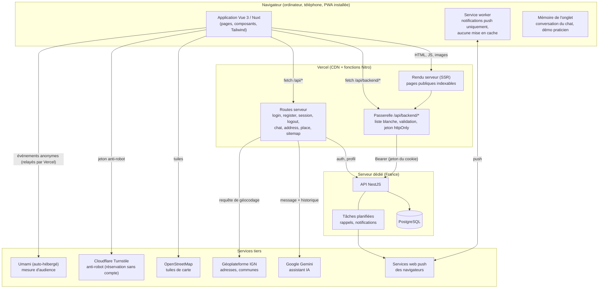

# Architecture technique

Périmètre : le site (ce dépôt) et ses relations avec l'API, la base de données et les services tiers. L'API (NestJS) est dans un autre dépôt.

## Vue d'ensemble

## Composants

| Composant | Rôle | Emplacement |
|---|---|---|
| Application Nuxt | Pages, composants, états ; rendu côté serveur pour le référencement, puis hydratation | `app/` |
| Passerelle | Seul point d'entrée vers l'API : liste blanche des routes, validation des corps et des paramètres, ajout du jeton, retrait des champs privés, règles de mise en cache | `server/api/backend/[...path].ts` |
| Routes serveur | Connexion et inscription (pose des cookies), session, assistant IA (quota, appel de Gemini), adresses et communes (géocodage IGN), sitemap des fiches | `server/api/` |
| Service worker | Affiche les notifications reçues ; n'intercepte aucune requête | `public/sw.js` |
| Démo praticien | Faux serveur dans le navigateur (`fetch` intercepté) : aucun appel à l'API | `app/utils/demoMock.ts`, `app/plugins/demo.client.ts` |

## Données et leur emplacement

| Donnée | Où | Durée |
|---|---|---|
| Comptes, rendez-vous, fiches, préférences, abonnements push | Base PostgreSQL de l'API (France) | Voir [donnees-personnelles.md](donnees-personnelles.md) |
| Jeton d'authentification | Cookie `token`, `httpOnly`, `SameSite=Lax`, `Secure` en production | 7 jours |
| Témoins d'interface (`leya_session`, `leya_role`, `leya_praticien`) | Cookies lisibles, sans donnée sensible (aucun droit n'en découle : l'API contrôle tout) | 7 jours |
| Conversation avec l'assistant | Mémoire de l'onglet | Fermeture de l'onglet |
| Démo praticien | `sessionStorage` + cookie `leya_demo` (données fictives) | Fermeture de l'onglet |
| Compteur de messages du jour | `localStorage` (affichage) + cache serveur (quota réel) | 1 jour |

## Choix de conception

- **Une seule porte vers l'API.** Le navigateur ne connaît pas l'adresse de l'API ; la passerelle est testée (`tests/unit/gateway.test.ts`) pour vérifier que seules les routes prévues passent.
- **Les secrets restent côté serveur** : clé Gemini, jeton d'authentification (jamais lisible par JavaScript), clé secrète Turnstile (côté API uniquement).
- **Les contrôles d'accès sont dans l'API.** Les gardes de pages du site (`app/middleware/`) servent à l'interface ; falsifier un cookie d'interface ne donne aucun droit.
- **Mise en cache prudente.** Seules les routes publiques sont mises en cache partagé (CDN) ; toute réponse authentifiée est en `no-store`.
- **Dégradation douce.** Carte : si le fond ne charge pas, un message invite à utiliser la liste ; assistant : message clair en cas de limite atteinte ou de service indisponible.
- **Évolutivité.** Le site est sans état (état dans l'API et dans les cookies) : Vercel multiplie les instances sans coordination. Le quota du chat est un cache par instance ; pour un trafic élevé, il devrait passer dans un stockage partagé (Redis ou la base).

## Limites connues

- Le quota quotidien du chat est tenu dans le cache d'une instance serverless : approximatif, à renforcer côté API en cas d'abus.
- La région d'exécution des fonctions Vercel n'est pas fixée dans le dépôt ; voir [deploiement-ci-cd.md](deploiement-ci-cd.md).
