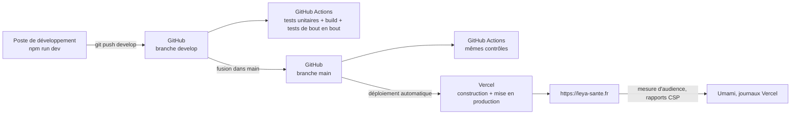

# Déploiement, intégration continue et exploitation

## Chaîne de livraison

| Étape | Outil | Détail |
|---|---|---|
| Développement | Nuxt en mode développement | Rechargement à chaud ; faux serveur local (non versionné) pour tester sans comptes réels |
| Contrôle automatique | GitHub Actions (`.github/workflows/ci.yml`) | À chaque push sur `main` ou `develop` et chaque demande de fusion : `vitest` (46 tests), construction (`npm run build`), Playwright sur le site construit (46 tests, dont accessibilité). Rapports conservés 14 jours |
| Mise en production | Vercel (liaison Git) | Chaque push sur `main` déclenche une construction puis une mise en ligne ; chaque branche a aussi une adresse d'aperçu |
| Retour arrière | Vercel | Une version précédente peut être remise en production en un clic (« Promote to Production »), sans reconstruire |
| Secrets | Variables d'environnement Vercel | Clé Gemini, adresse de l'API, clé publique Turnstile, réglages Umami ; rien n'est versionné (`.env` ignoré) |

La CI et Vercel s'exécutent en parallèle : Vercel déploie `main` sans attendre les tests. Pour bloquer un déploiement en cas d'échec, il faut activer la protection de branche dans GitHub (vérification obligatoire) ou utiliser « Ignored Build Step » côté Vercel : non configuré à ce jour.

## Environnements

| Environnement | Hébergement | Données |
|---|---|---|
| Local | Poste du développeur | API de production en lecture par défaut (`NUXT_API_BASE` permet de viser un autre serveur) |
| Intégration continue | Machine GitHub éphémère | Site construit lancé sur le port 3100 ; interroge l'API de production en lecture |
| Production | Vercel (site) + serveur dédié en France (API et base) | Données réelles |

## En-têtes et sécurité de déploiement

Posés par `nuxt.config.ts` (`routeRules`) : `Strict-Transport-Security` (Vercel), `X-Content-Type-Options: nosniff`, `X-Frame-Options: DENY` (`SAMEORIGIN` pour l'aperçu de la fiche), `Referrer-Policy`, `Permissions-Policy` (géolocalisation limitée au site), `Cross-Origin-Opener-Policy`, **CSP en mode rapport seul** (violations envoyées à `/api/csp-report`). Le service worker est servi avec `Cache-Control: no-cache`.

## Performances et suivi

- **Audit du 13/10/2026** (production, mobile émulé en 4G lente) : accueil LCP 4,0 s, CLS 0 ; ordinateur LCP 0,5 s. Pages de médecine : LCP 2,5 s. Depuis, `favicon.png` est passé de 342 Ko à 19 Ko ; une nouvelle mesure est à refaire.
- **Audience** : Umami auto-hébergé (pages, étapes de recherche et de réservation, vitesse d'affichage), consultable par l'équipe.
- **Tableau de bord** : les métriques Vercel (requêtes, durées d'exécution des fonctions, erreurs) et Umami servent de tableaux de bord ; aucun tableau de bord de supervision dédié n'est en place.
- **Montée en charge** : non testée. Le site est sans état et s'appuie sur le CDN pour les pages publiques ; la capacité réelle est limitée par l'API et sa base (un seul serveur).

## Points d'attention à traiter

1. **Région d'exécution des fonctions.** L'en-tête `x-vercel-id: cdg1::iad1::…` de la production indique des fonctions exécutées à Washington (iad1) alors que l'API est en France : latence supplémentaire à chaque appel serveur et transit des cookies par les États-Unis. À confirmer dans le tableau de bord Vercel ; si c'est le cas, fixer la région de Paris (`cdg1`) dans la configuration Nitro/Vercel.
2. **Protection de la branche `main`** : exiger que la CI passe avant la fusion.
3. **CSP bloquante** : à activer après examen des rapports, en autorisant les tuiles OpenStreetMap, Turnstile et Umami.
4. **Test de charge simple** (par exemple k6 ou Artillery sur l'annuaire et la recherche) pour documenter la capacité.
