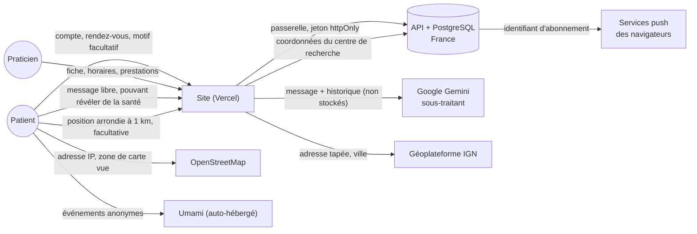

# Données personnelles : flux et registre des traitements

Document de travail pour le dossier (RGPD). Il décrit l'état du site à la date indiquée et **doit être validé par le responsable du traitement** ; il ne constitue pas un avis juridique. Il s'appuie sur la politique de confidentialité publiée (`/politique-de-confidentialite`).

*Version du 16/10/2026.*

## Principes appliqués

- **Minimisation** : aucune donnée de santé n'est demandée ; le motif d'un rendez-vous est facultatif et limité à 500 caractères ; le site ne stocke pas la conversation avec l'assistant.
- **Séparation** : le site n'a pas de base de données propre ; les données de comptes et de rendez-vous sont dans l'API (France) ; le jeton d'accès n'est jamais lisible par le navigateur (cookie `httpOnly`).
- **Transparence** : politique de confidentialité, mentions légales, CGU, mention « assistant IA » dans le chat, bandeau de position facultative sous le bouton « près de moi ».
- **Droits** : export des données, suppression du compte, opposition aux statistiques d'usage (dans « Mon compte »), retrait ou correction d'une fiche d'annuaire par courriel.
- **Pas de cookie publicitaire ni de suivi tiers** ; cookies strictement nécessaires uniquement ; mesure d'audience sans cookie.

## Flux de données

## Registre des traitements

| # | Traitement | Finalité | Personnes | Données | Base légale | Destinataires | Durée | Mesures |
|---|---|---|---|---|---|---|---|---|
| 1 | Comptes | Créer et gérer un compte | Patients, praticiens | E-mail, mot de passe (chiffré côté API), nom, téléphone | Exécution du contrat | API (France) | Durée du compte, suppression à la demande | Jeton `httpOnly`, validation des entrées, mot de passe jamais exposé |
| 2 | Rendez-vous | Réserver, confirmer, annuler | Patients, praticiens | Créneau, prestation, motif facultatif (500 car.), coordonnées d'un invité | Exécution du contrat ; consentement pour le motif | API ; le praticien concerné | Voir politique ; à compléter côté API | Motif exclu des notifications et du lien d'agenda ; consigne donnée à l'API de ne pas le journaliser |
| 3 | Réservation sans compte | Réserver sans créer de compte | Invités | Prénom, nom, e-mail, téléphone, consentements, motif | Consentement | API ; le praticien | À confirmer côté API (une demande non traitée expire sous 48 h) ; effaçable par l'invité avec le lien secret | Anti-robot Turnstile ; lien de gestion de 43 caractères ; suppression des données par l'invité |
| 4 | Assistant IA | Orienter vers une médecine | Utilisateurs connectés | Messages (peuvent révéler de la santé) | Consentement explicite | Google (Gemini), sous-traitant | **Non conservés** par le site | Avertissement avant saisie ; limite quotidienne ; aucune journalisation du contenu ; conversation uniquement en mémoire de l'onglet |
| 5 | Annuaire | Présenter les praticiens | Praticiens | Nom, spécialités, adresse et téléphone professionnels, site | Intérêt légitime ; contrat pour une fiche revendiquée | Public | Tant que la fiche est en ligne ; retrait sur demande | Fiches non revendiquées en `noindex` ; source indiquée |
| 6 | Revendication de fiche | Vérifier l'identité | Praticiens | Message, RPPS/SIRET facultatifs, identité du compte | Intérêt légitime | Équipe d'administration | Instruction + 1 an | Visible des seuls administrateurs |
| 7 | Position approximative | Chercher « près de moi » | Visiteurs | Latitude/longitude arrondies à 1 km | Consentement (navigateur) | API (paramètres de requête) | Non conservée | Demandée au clic ; non transmise à l'assistant |
| 8 | Notifications push | Prévenir d'une demande ou d'un rendez-vous | Utilisateurs connectés | Identifiant d'abonnement du navigateur (adresse du service push, clés) | Consentement | API ; service push du navigateur | Jusqu'à désactivation ou déconnexion | Contenu neutre (ni nom, ni motif) ; abonnement retiré à la déconnexion |
| 9 | Lien d'agenda | Afficher ses rendez-vous dans son agenda | Praticiens | Prestation et prénom du patient (jamais motif, téléphone ni e-mail) | Consentement (action volontaire) | Application d'agenda du praticien | Jusqu'à désactivation du lien | Jeton secret haché côté API, régénérable et révocable |
| 10 | Mesure d'audience | Statistiques de fréquentation | Visiteurs | Pages, appareil, pays/ville approximatifs ; IP non conservée | Intérêt légitime | Umami auto-hébergé (via Vercel) | 13 mois | Aucun cookie ; respect de « Do Not Track » |
| 11 | Statistiques d'usage | Améliorer le service | Utilisateurs connectés | Type d'action, date, rôle, identifiant pseudonymisé | Intérêt légitime | Équipe | 13 mois | Droit d'opposition dans « Mon compte » |
| 12 | Carte | Afficher la carte | Visiteurs | Adresse IP, zone affichée | Intérêt légitime | OpenStreetMap | Selon OpenStreetMap | Mentionné dans la politique ; carte non chargée hors vue Carte et fiche |
| 13 | Hébergement | Servir le site | Tous | Journaux techniques (IP, URL) | Intérêt légitime | Vercel | Selon l'hébergeur | Voir « points à traiter » |

## Points à traiter

1. **Durées côté API** : le registre reprend la politique publiée ; les durées précises des rendez-vous, des invités et des abonnements push sont à confirmer avec l'équipe qui tient l'API.
2. **Transferts hors Union européenne** : Google (Gemini) et Vercel sont des sous-traitants américains ; vérifier les clauses contractuelles types et le cadre « Data Privacy Framework ». Les fonctions Vercel sont désormais configurées en région de Paris (`vercel.json`, voir [deploiement-ci-cd.md](deploiement-ci-cd.md)) : à vérifier après déploiement.
3. **Politique de confidentialité à compléter** : notifications push (traitement 8), lien d'agenda (traitement 9) et réservation sans compte (traitement 3) doivent y figurer explicitement.
4. **Analyse d'impact (AIPD)** : le traitement 4 (messages pouvant révéler de la santé, sous-traitant hors UE) justifie d'en faire une, même légère : voir [aipd.md](aipd.md).
5. **Données de santé** : le motif d'un rendez-vous peut en contenir ; le consentement doit être recueilli au moment de la saisie (c'est le cas pour la réservation sans compte via `consentHealthData`).
6. **Fiches non revendiquées** : droit d'opposition et de retrait déjà prévus ; vérifier la procédure interne (délai d'un mois).
