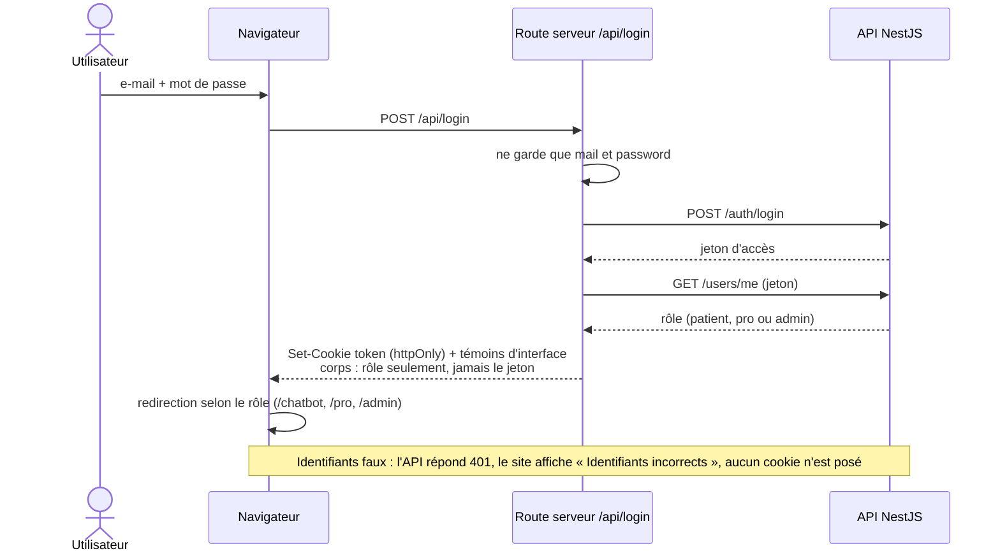
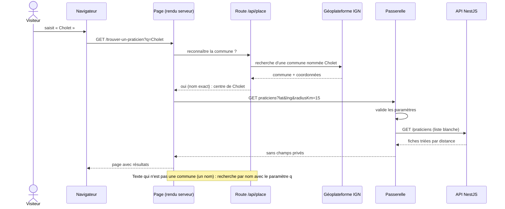
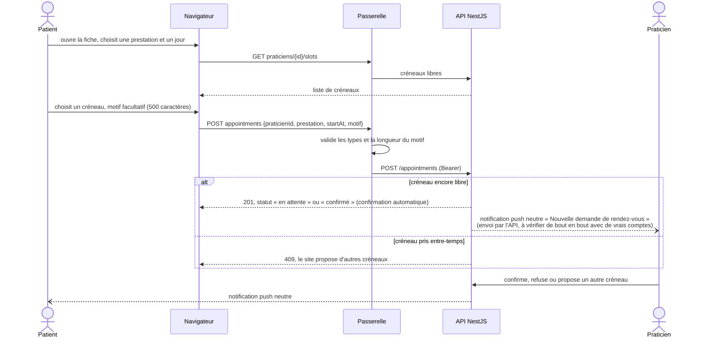
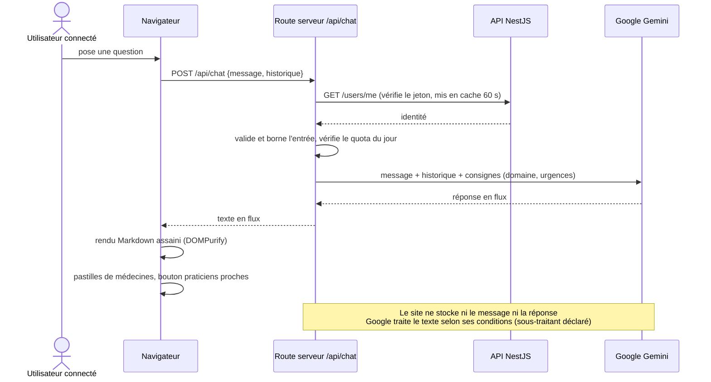
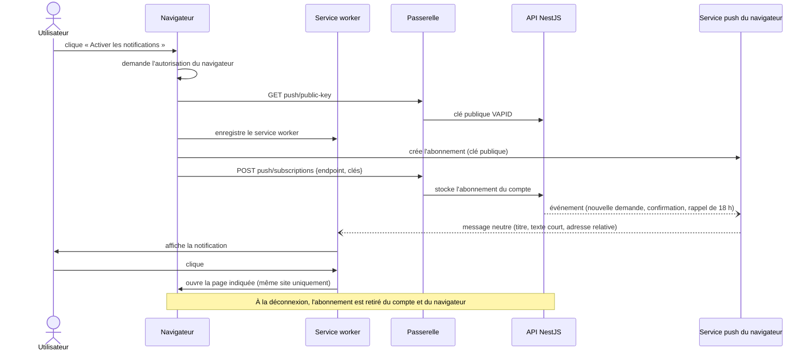

# Diagrammes de séquence

Les principaux parcours, avec ce qui transite et où. (« Passerelle » = `/api/backend/*`.)

## 1. Connexion

## 2. Recherche d'un praticien par ville

## 3. Réservation d'un rendez-vous (compte patient)

Réservation **sans compte** : même parcours avec un jeton anti-robot Cloudflare Turnstile et un lien de gestion secret (43 caractères) renvoyé à la création ; c'est l'API qui vérifie le jeton.

## 4. Assistant IA

## 5. Notifications push

